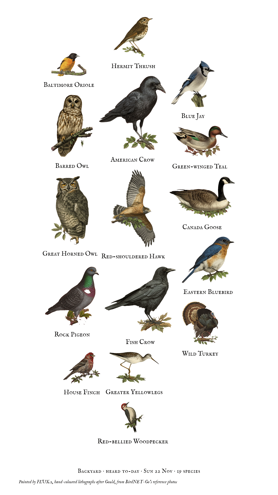

# samsung-epaper-birds

A Node.js service that turns what [BirdNET-Go](https://github.com/tphakala/birdnet-go) has heard into a page of
**1800s natural-history plates** for a **Samsung EM32DX (EMDX)** Spectra 6 e-paper panel, and delivers it over Samsung MDC.
It is the sibling of `samsung-epaper-calendar` and shares its panel conversation (wake, push, wait for the fetch, sleep,
Home Assistant over MQTT); only the picture is different. The look follows
[tesserae-widget-backyard-birds](https://github.com/dmellok/tesserae-widget-backyard-birds): aged cream paper, IM Fell type,
double-ruled folio pages, hand-coloured lithograph plates after Gould and Audubon.

- **BirdNET-Go** supplies today's species (`/api/v2/analytics/species/daily`), and a reference photo per species.
- **FLUX.2** paints each species once, as a plate, and the plate is kept on disk. With a reference photo it *edits* the photo
  into the chosen style (so the plumage is right); without one it paints from the name (text-to-image).
- Each plate is **cut from its paper** (`src/cutout.mjs`) and the cut-outs are **packed** into a cluster (`src/pack.mjs`: the biggest in the middle, the rest at the nearest free spot, pulled together, then grown to fill the page at the panel's full resolution). Painting the birds one at a time and combining them keeps each bird accurate and cached; one FLUX.2 pass for the whole flock would repaint every bird whenever the set changed.
- A **local chat model** (OpenAI-compatible) writes a one-line field note per species in a Victorian voice.
- Until a plate exists, its place shows a hatched "plate in preparation" card; when it lands the picture changes and the
  panel is redrawn.



## Layouts and styles

| Layout | Shows |
| --- | --- |
| `cluster` (default) | The day's birds cut out of their plates and grouped on one sage-green page, the most heard biggest and in the middle, each with its name below, and a line at the foot (garden, date, species count) |
| `folio` | One bird (the one heard last, or the most heard) as a full plate, its name, field note and first-heard time, and the other birds listed beneath |
| `specimen` | Up to six birds on one sheet, each with its plate number, name and Latin name |

Styles: `gould` (hand-coloured lithograph on aged paper, default), `audubon` (watercolour plate), `engraving` (black ink, best on
mono panels), `woodblock` (ukiyo-e) and `midcentury` (flat geometric, after Harper). Each style keeps its own plates, so switching
costs nothing after the first time.

## Run

```sh
cp .env.example .env     # set BIRDNET_URL, the FLUX.2 backend, and the panel's DISPLAY_HOST / DISPLAY_PIN
docker compose up -d --build
```

On Linux the compose file uses host networking, so the panel can download its pictures from the machine's own LAN address (found
each time a picture is pushed). On **Docker Desktop (Mac or Windows)** host networking does not reach your LAN; add the override
and set `PUBLIC_HOST` in `.env` to the computer's address on the panel's network, and keep the computer on that network:

```sh
docker compose -f docker-compose.yml -f docker-compose.desktop.yml up -d --build
```

Plates, cut-outs and the panel's remembered state are kept in the `bird-data` volume (`/data`). The helper scripts are in the image:

```sh
docker compose exec -u node samsung-epaper-birds node scripts/paint-today.mjs gould   # paint today's birds in a style ahead of time
docker compose exec -u node samsung-epaper-birds node scripts/render-today.mjs gould /data/gould.png   # render a page without touching the panel
```

A GitHub Actions workflow runs the tests and a test build on every push, and `docker.yml` publishes a multi-arch image to
`ghcr.io/<owner>/<repo>` when you push a version tag.

Without a panel host and PIN it only renders and serves: open `http://<host>:<PORT>/` for the current frame,
`/preview?layout=folio&style=audubon` to try other looks, and `/plates` for the painted plates.
`POST /api/plates/repaint?species=Strix%20varia&style=gould` throws a plate away and paints it again.
The control API and Home Assistant entities match the calendar's (`/api/displays/<id>/refresh`, `.../redraw`, `.../layout?name=`,
`.../theme?name=` which here switches the art style).

## FLUX.2 backends

| `IMAGE_BACKEND` | Talks to |
| --- | --- |
| `openai` | `POST {IMAGE_API_URL}/images/generations` and `/images/edits` (OpenAI images API; model `IMAGE_MODEL`) |
| `comfyui` | A ComfyUI server running FLUX.2 (`COMFY_URL`): text-to-image, or a reference-photo edit through `ReferenceLatent` |
| `none` | No painting |

**Check which one your server speaks.** The OpenAI-compatible server at `192.168.1.249:8000` was found to serve only a chat
model (no `/v1/images/*` routes), while FLUX.2 (`flux2_dev_fp8mixed`, `flux-2-klein-base-9b`) is loaded in ComfyUI on `:8188`,
so `.env.example` selects `comfyui`. Put a gateway that exposes `/v1/images/*` in front of it and switch to `openai` with no code change.
A plate takes a few minutes on the first run (model load) and less afterwards; at most `PLATES_PER_DAY` new plates are made a day.

## Rules this service keeps

- The panel has six inks: text and rules are on the `content` layer (snapped to inks), paper and plates on the `art` layer
  (sent in color for the panel to dither, or dithered here with `ART_DITHER`). See `src/quantize.mjs`.
- Nothing on the page depends on the time of day, so a redraw happens only when the birds or plates change: the page shows
  the date, not a clock, and no counts (the set of birds and the plate numbers, by first-heard order, are stable between detections).
- A failed BirdNET-Go lookup keeps what the panel shows (the render fails, nothing is pushed). A failed painting is retried after 6 hours.

## Tests

`npm test` (no network: fake panel, fake BirdNET-Go/FLUX.2 servers). `npm run demo` renders both layouts to `docs/images/`;
`npm run plate -- "Carolina Wren" "Thryothorus ludovicianus" gould` paints one plate now.

Fonts: IM Fell English (SIL OFL, licences in `fonts/`), DejaVu Sans as fallback. Plates are AI-made; BirdNET-Go and FLUX.2 are credited in the page footer.

## The cluster page

`MAX_BIRDS` (default 16) birds are shown, busiest first. `SIZE_BY=calls` makes the most heard biggest (the biggest sits in the middle);
`equal` makes them all the same. `CLUSTER_PAPER` is the page colour. A bird whose plate is still being painted is a faint oval until it lands.
The cut-out finds the paper by spreading in from the picture's edges through pixels that stay close to the paper colour, so the plate prompts
ask FLUX.2 for a flat, shadowless ground; a pale bird on pale paper keeps its outline. Cut-outs are kept beside the plates (`*.cut.png`).
Plates are 1024x1024 by default (`PLATE_WIDTH`/`PLATE_HEIGHT`), which also suits an image server that only makes 1024x1024.
